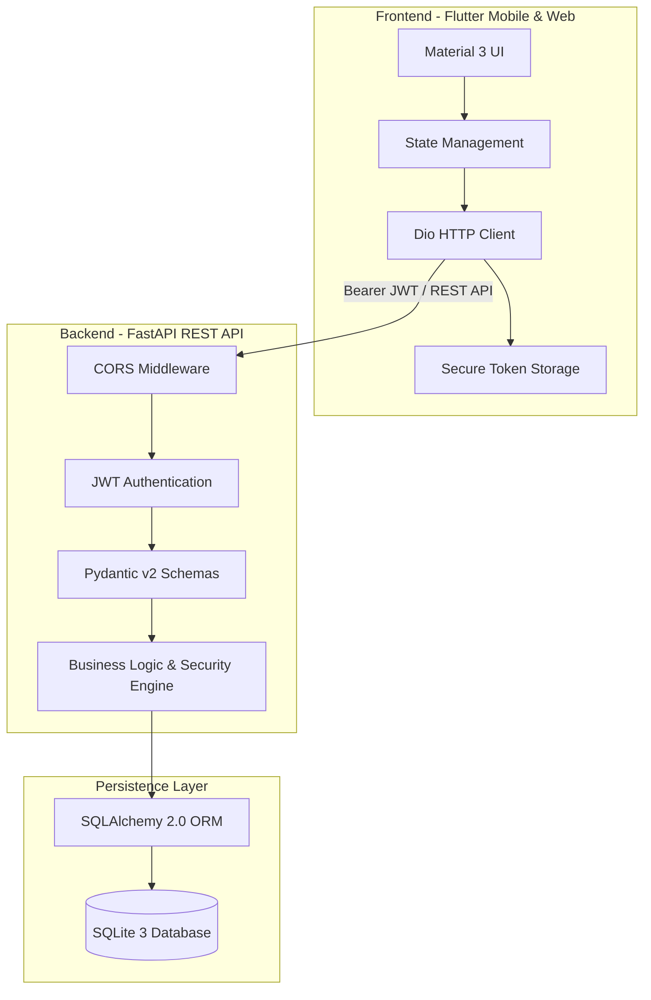
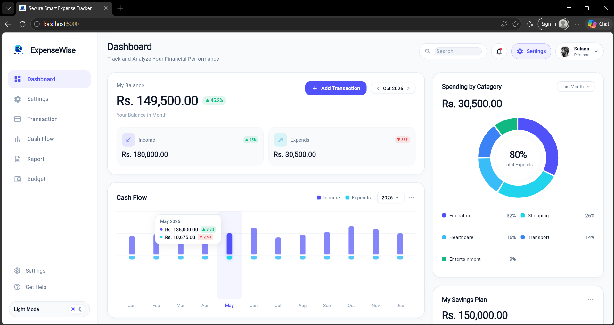
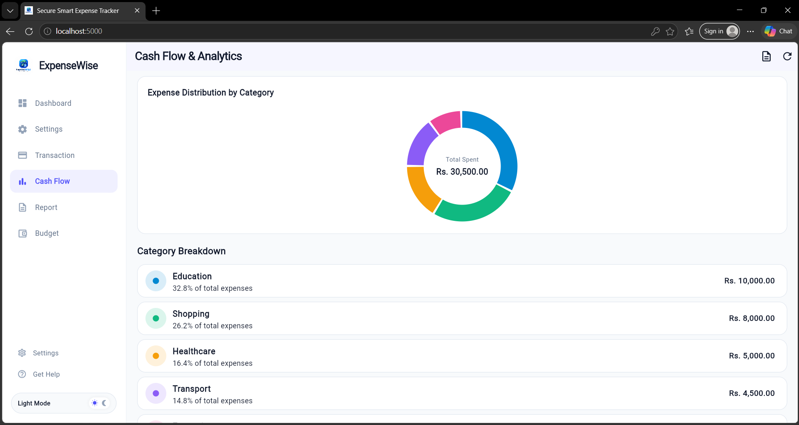
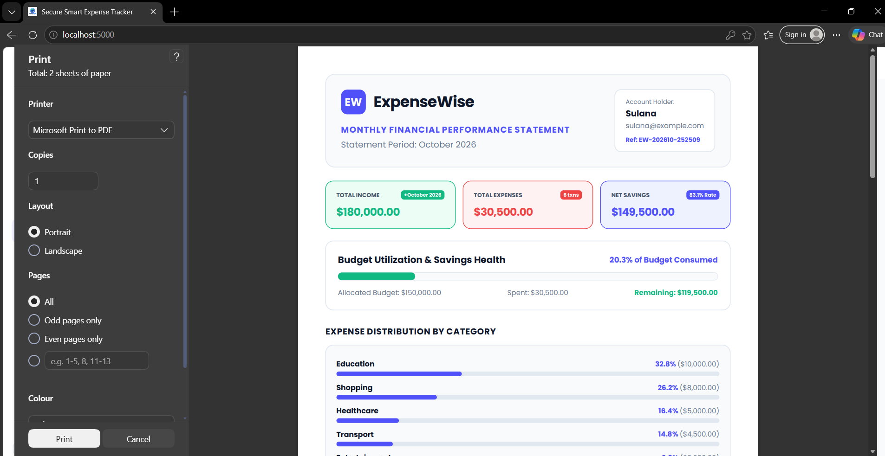

# 🛡️ ExpenseWise - Secure Smart Expense Tracker

<div align="center">


<p align="center">
  <b>A Production-Grade, Security-Hardened Personal Finance & Wealth Management System</b><br>
  Built with Flutter for Mobile & Web, and a hardened FastAPI REST backend with strict user data isolation.
</p>

</div>

---

## 📌 Project Overview

**ExpenseWise** is a full-stack personal finance and expense management system engineered with a **defense-in-depth security architecture**. Built to meet modern financial application standards, it provides comprehensive budgeting, analytics, and transaction tracking while remaining resilient against common OWASP vulnerabilities like **Insecure Direct Object References (IDOR)**, **Broken Authentication**, and **Credential Stuffing**.

---

## 🏗️ System Architecture



---

## 📸 Application Preview & Screenshots

<div align="center">

### 1. Financial Health Dashboard


<br/><br/>

### 2. Expense Analytics & Visual Cash Flow


<br/><br/>

### 3. Transaction Management & Records


</div>

---

## 🛡️ Cybersecurity Defense Features

| Security Mechanism | Implementation | Threat Mitigated |
| :--- | :--- | :--- |
| **Password Hashing** | **Argon2id** (OWASP Recommended) via `pwdlib` | Rainbow table & brute-force offline cracking |
| **Stateless Auth** | **HMAC-SHA256 JWT** tokens with strict expiration | Session hijacking & server-side session exhaustion |
| **Zero-Trust Access (IDOR)** | Queries enforce `WHERE user_id = current_user.id` | Cross-user data leaks & unauthorized modifications |
| **Input Validation** | Strict **Pydantic v2** sanitization and type coercion | SQL Injection & Malformed Payload attacks |
| **Credential Safety** | Generic authentication error messages | Username enumeration |
| **Safe CSV Exports** | Formula injection sanitization on spreadsheet export | CSV / Formula Execution vulnerabilities |

---

## ✨ Application Features

- **📊 Comprehensive Financial Dashboard:** Live net balance, total income, total expenditures, and monthly savings rate.
- **📈 Visual Analytics & Reports:** Spending categorized with interactive pie charts and cash-flow breakdowns.
- **🎯 Dynamic Budgeting:** Monthly spending limits with automated **80% Warning** and **Over-Budget** alerts.
- **💵 Transaction Management:** Full CRUD operations with category tagging, date pickers, and currency formatting (LKR / Rs.).
- **📥 Statement Export:** One-click CSV financial statement download.
- **📱 Responsive UI:** Optimized for Android devices and modern desktop/mobile web browsers.

---

## 📁 Repository Structure

```plaintext
ExpenseWise/
├── backend/                  # FastAPI REST API Backend
│   ├── app/
│   │   ├── config.py         # Pydantic Settings & Environment Config
│   │   ├── database.py       # SQLAlchemy Session & Engine Setup
│   │   ├── models.py         # Database Entities (User, Transaction, Budget)
│   │   ├── schemas.py        # Pydantic Request & Response Schemas
│   │   ├── security.py       # Argon2 & JWT Crypto Helpers
│   │   ├── routers/          # API Route Controllers (Auth, Tx, Budgets, Reports)
│   │   └── main.py           # Application Entry Point & Middleware
│   ├── tests/                # Automated Test Suite (23 test cases)
│   └── requirements.txt      # Python Dependencies
├── mobile/                   # Flutter Mobile & Web Client
│   ├── lib/
│   │   ├── core/             # Theme, Constants, Network Client, Security Storage
│   │   ├── features/         # Clean Feature Modules (Auth, Dashboard, Transactions)
│   │   ├── models/           # Dart Data Models
│   │   ├── providers/        # State Management Notifiers
│   │   └── main.dart         # Flutter Entrypoint
│   └── pubspec.yaml          # Flutter Dependencies
├── docs/                     # Architectural & Security Documentation
│   ├── architecture.md       # High-Level Architecture
│   ├── security.md           # Security Defense Specification
│   ├── setup_guide.md        # Comprehensive Setup Instructions
│   └── test_plan.md          # Test Matrix & Verification Documentation
├── .env.example              # Environment Configuration Template
├── .gitignore                # Production Git Exclusion Rules
└── README.md                 # Project Documentation
```

---

## 🧪 Automated Testing Suite

The backend contains **23 automated tests** covering authentication security, IDOR prevention, and business logic:

```bash
cd backend
pytest -v
```

```plaintext
============================= test session starts =============================
collected 23 items

tests/test_auth.py::test_user_registration_success PASSED                [  4%]
tests/test_auth.py::test_registration_duplicate_email_rejected PASSED    [  8%]
tests/test_auth.py::test_registration_password_mismatch_rejected PASSED  [ 13%]
tests/test_auth.py::test_registration_weak_password_rejected PASSED      [ 17%]
tests/test_auth.py::test_login_success PASSED                            [ 21%]
tests/test_auth.py::test_login_invalid_password_fails_with_generic_message PASSED [ 26%]
tests/test_auth.py::test_login_nonexistent_user_fails_with_generic_message PASSED [ 30%]
tests/test_auth.py::test_get_current_user_profile PASSED                 [ 34%]
tests/test_auth.py::test_unauthenticated_request_rejected PASSED         [ 39%]
tests/test_auth.py::test_expired_jwt_rejected PASSED                     [ 43%]
tests/test_auth.py::test_tampered_jwt_signature_rejected PASSED          [ 47%]
tests/test_budgets.py::test_set_and_get_monthly_budget PASSED            [ 52%]
tests/test_budgets.py::test_budget_warning_and_overbudget_alerts PASSED  [ 56%]
tests/test_budgets.py::test_income_does_not_count_towards_budget_usage PASSED [ 60%]
tests/test_reports.py::test_monthly_report_and_savings_rate PASSED       [ 65%]
tests/test_reports.py::test_zero_income_savings_rate_safety PASSED       [ 69%]
tests/test_reports.py::test_csv_export_isolated_to_authenticated_user PASSED [ 73%]
tests/test_transactions.py::test_create_income_and_expense_transaction PASSED [ 78%]
tests/test_transactions.py::test_reject_negative_or_zero_amount PASSED   [ 82%]
tests/test_transactions.py::test_list_and_filter_transactions PASSED     [ 86%]
tests/test_transactions.py::test_idor_user_a_cannot_read_user_b_transaction PASSED [ 91%]
tests/test_transactions.py::test_idor_user_a_cannot_update_user_b_transaction PASSED [ 95%]
tests/test_transactions.py::test_idor_user_a_cannot_delete_user_b_transaction PASSED [100%]

======================= 23 passed in 3.63s =======================
```

---

## 🚀 Quick Setup & Run

### 1. Backend Server
```bash
cd backend
python -m venv venv
# Windows:
.\venv\Scripts\Activate.ps1
# Linux/macOS:
source venv/bin/activate

pip install -r requirements.txt
uvicorn app.main:app --reload --host 0.0.0.0 --port 8000
```
Swagger UI Documentation: `http://127.0.0.1:8000/docs`

### 2. Flutter Mobile & Web Client
```bash
cd mobile
flutter pub get

# To run in Web browser:
flutter run -d chrome

# To run on connected Android Device:
flutter run
```

---

## 👤 Author

**Sulana Uduwana**  
- Email: [sulanav02@gmail.com](mailto:sulanav02@gmail.com)  
- GitHub: [@Sulana-UX](https://github.com/Sulana-UX)

---

## 📄 License

This project is licensed under the MIT License - see the LICENSE file for details.
