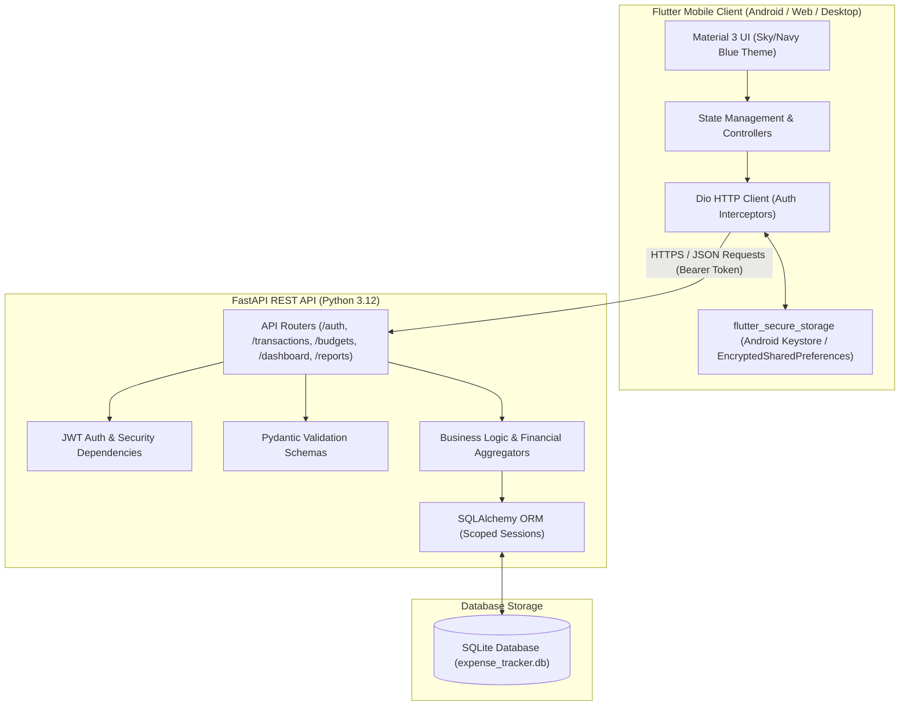

# Architecture & System Design

## 1. Overview
The **Secure Smart Expense Tracker** is designed with a modern client-server architecture separating the mobile user interface (Flutter) from the business logic, security policies, and persistence layer (FastAPI + SQLite).

## 2. Key Architectural Decisions

### A. Strict Client-Server Separation
The mobile application **never communicates directly with the database**. All queries, updates, and aggregations are mediated through authenticated REST endpoints. This enforces business rules, validates all inputs on the server, and prevents client-side tampering.

### B. Stateless JWT Authentication
* After a user registers and logs in with valid credentials, the server signs and returns a short-lived JSON Web Token (JWT).
* Subsequent client requests pass this token in the `Authorization: Bearer <token>` header.
* The backend derives the `current_user` directly from the validated token payload (`sub` claim) on every single request.

### C. Prevention of IDOR (Insecure Direct Object Reference)
* No endpoint accepts a `user_id` parameter from client queries or form bodies to determine data ownership.
* Every database query explicitly filters by `user_id == current_user.id`.
* If User A attempts to read, edit, or delete a transaction ID belonging to User B, the backend returns a `404 Not Found` (or `403 Forbidden`), preventing cross-user data leakage.

### D. Financial Precision and Minor Units
* To prevent binary floating-point rounding errors (e.g. `0.1 + 0.2 != 0.3` in standard IEEE 754 floating point arithmetic), amounts are validated strictly with 2 decimal places and calculated with exact numeric representations.
